# TP Spring Data JPA — Gestion des produits

Application Java réalisée avec **Spring Boot**, **Spring Data JPA**, **H2 Database**, **Spring Web** et **Lombok**. Le projet permet de gérer des produits à travers une API REST et de tester les opérations CRUD.

## Technologies utilisées

- Java 21
- Spring Boot
- Spring Web (API REST)
- Spring Data JPA / Hibernate
- H2 Database
- Lombok
- Maven
- Swagger UI pour tester l'API (si configuré dans le projet)

## Fonctionnalités

- Ajouter un produit
- Consulter la liste des produits
- Consulter un produit par son identifiant
- Rechercher des produits par mot-clé
- Modifier un produit
- Supprimer un produit

## Structure du projet

```text
src/main/java/net/ayman/demo/
├── entities/
│   └── Product.java
├── repositories/
│   └── ProductRepository.java
├── web/
│   └── ProductRestController.java
└── DemoBdccSpringDataApplication.java

src/main/resources/
└── application.properties

screenshots/
└── Captures d'écran des tests et de la configuration
```

> Adaptez les noms de packages ou de classes dans cette section s'ils diffèrent dans votre projet.

## Configuration et lancement

1. Ouvrir le projet dans IntelliJ IDEA.
2. Vérifier que Java 21 est configuré comme SDK du projet.
3. Charger les dépendances Maven.
4. Lancer la classe `DemoBdccSpringDataApplication`.

Si le projet est configuré sur le port `8084`, l'API est accessible à l'adresse suivante :

```text
http://localhost:8084/api/products
```

Si la console H2 est activée dans `application.properties`, elle est disponible à :

```text
http://localhost:8084/h2-console
```

La base H2 en mémoire est temporaire : les données peuvent être perdues lorsque l'application s'arrête.

## Exemples de requêtes HTTP

Adaptez les URL ci-dessous si les routes de votre contrôleur sont différentes.

### Consulter tous les produits

```http
GET http://localhost:8084/api/products
```

### Ajouter un produit

```http
POST http://localhost:8084/api/products
Content-Type: application/json

{
  "name": "Ordinateur",
  "price": 7500.0,
  "quantity": 10
}
```

### Consulter un produit par ID

```http
GET http://localhost:8084/api/products/1
```

### Rechercher par nom

```http
GET http://localhost:8084/api/products/search?keyword=ordi
```

### Modifier un produit

```http
PUT http://localhost:8084/api/products/1
Content-Type: application/json

{
  "name": "Ordinateur portable",
  "price": 8200.0,
  "quantity": 8
}
```

### Supprimer un produit

```http
DELETE http://localhost:8084/api/products/1
```

## Captures d'écran

Les captures sont stockées dans le dossier [`screenshots/`](screenshots/).

### Création du projet et base de données

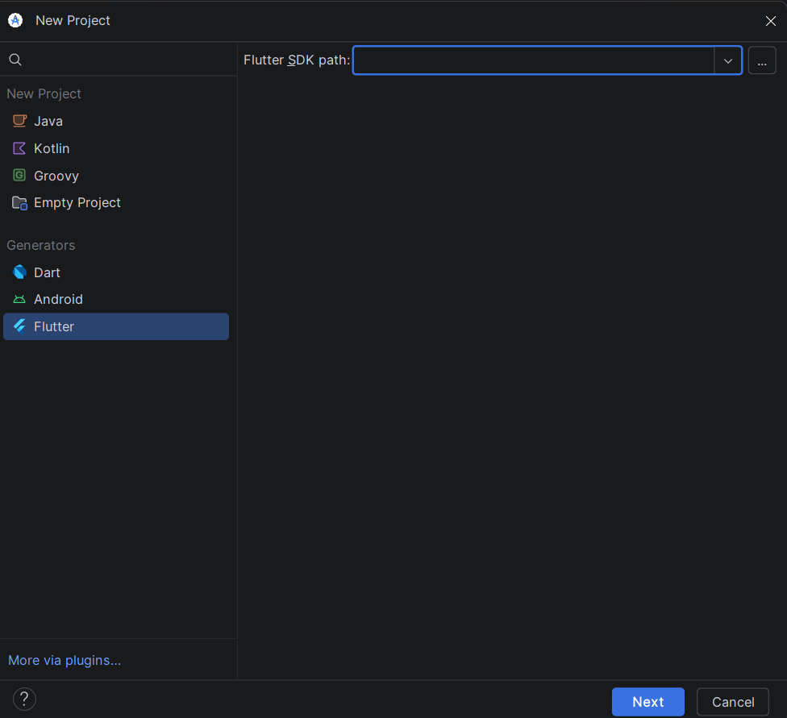

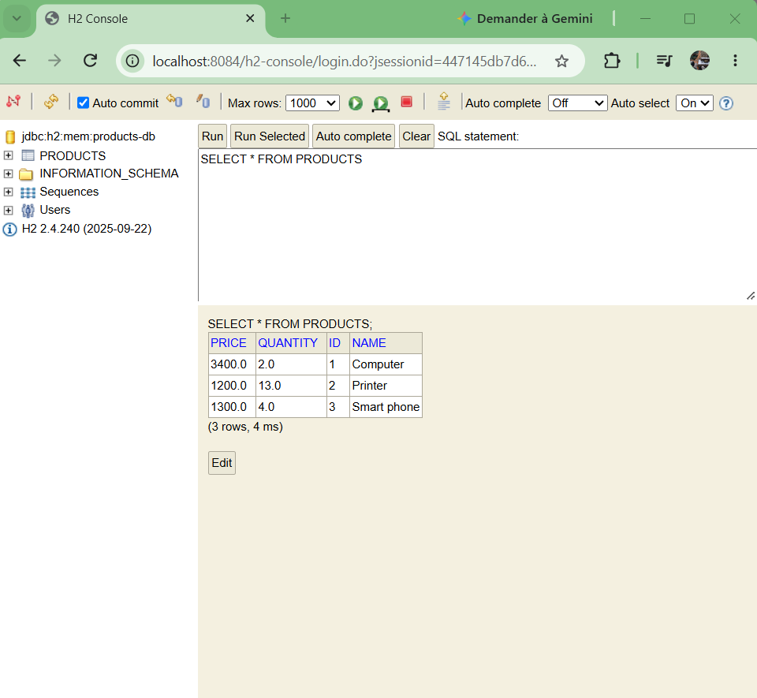

### Consultation et recherche

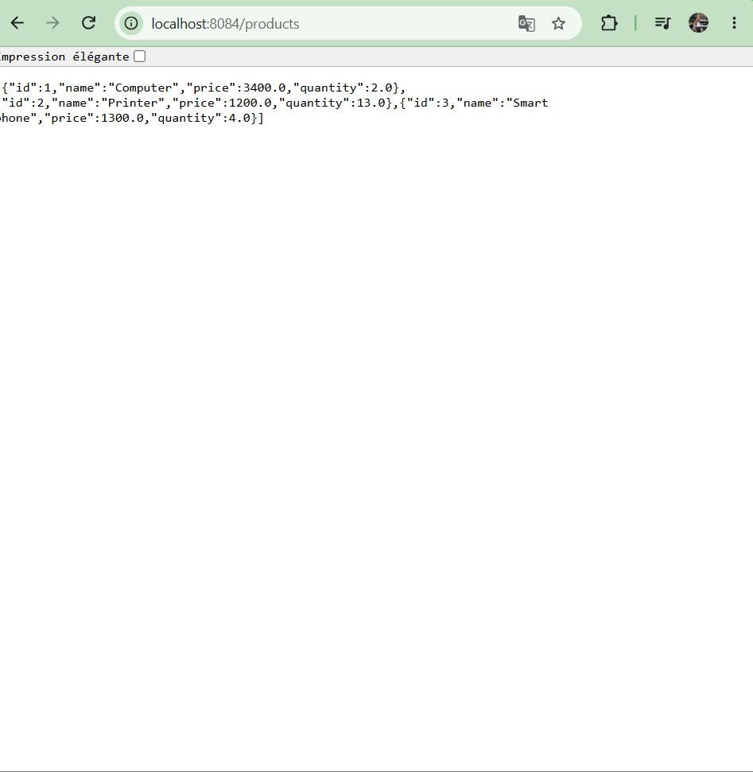

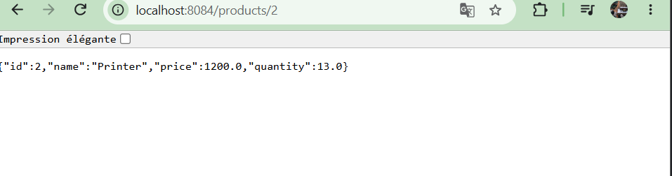

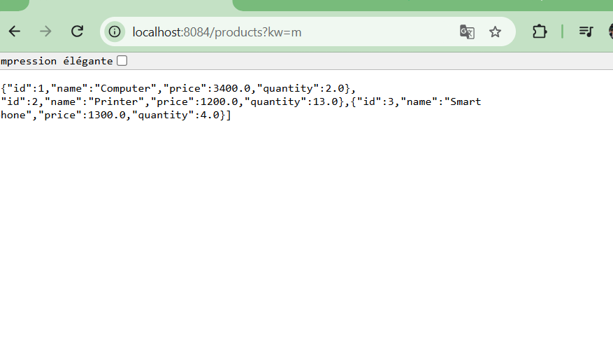

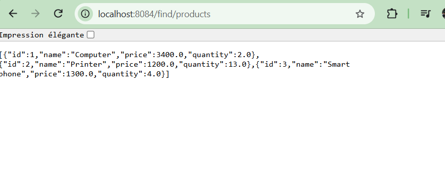

### Tests avec Swagger UI

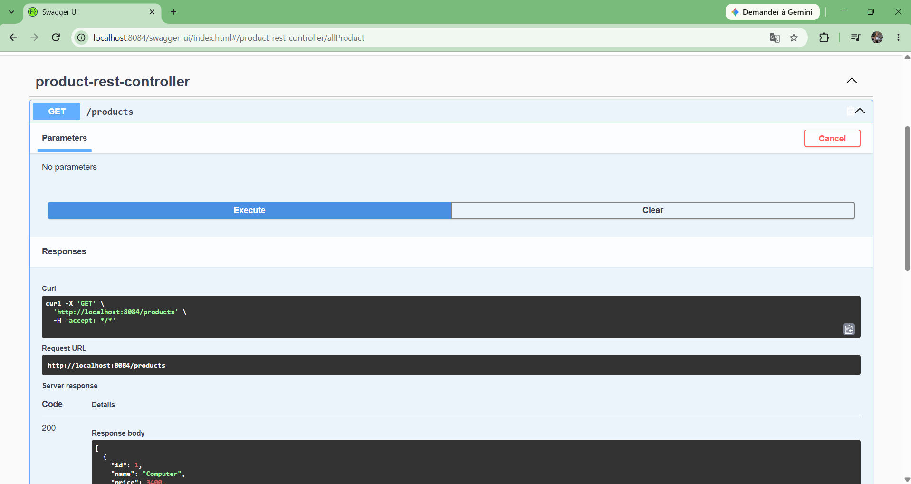

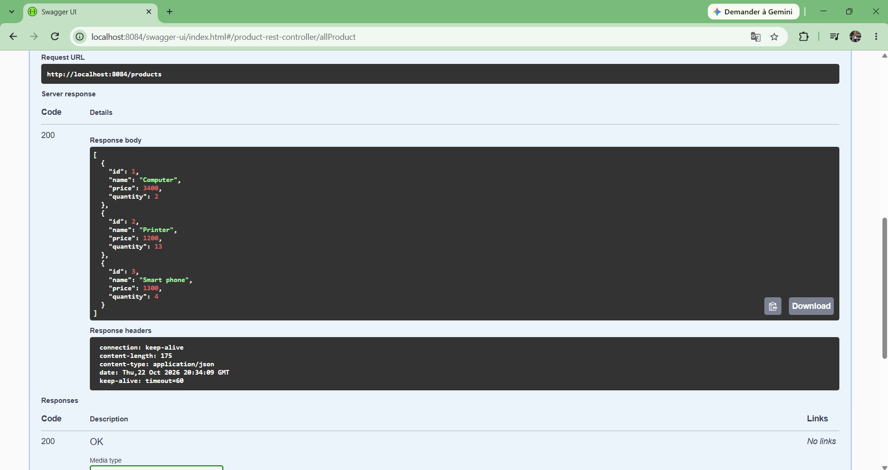

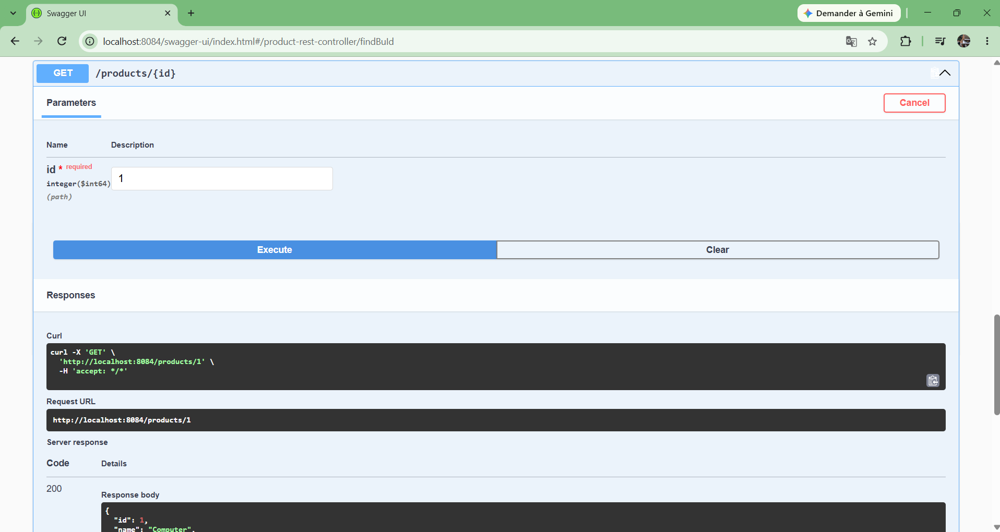

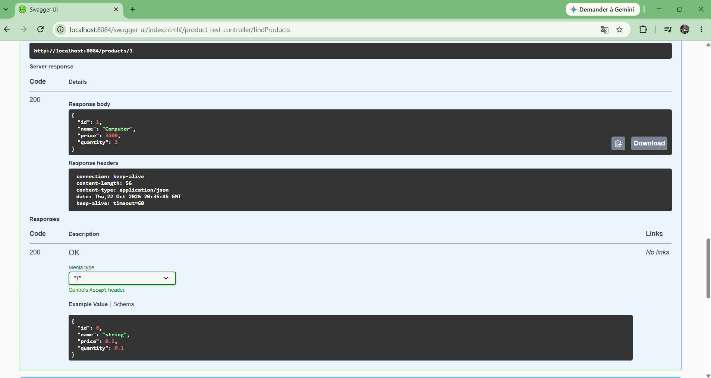

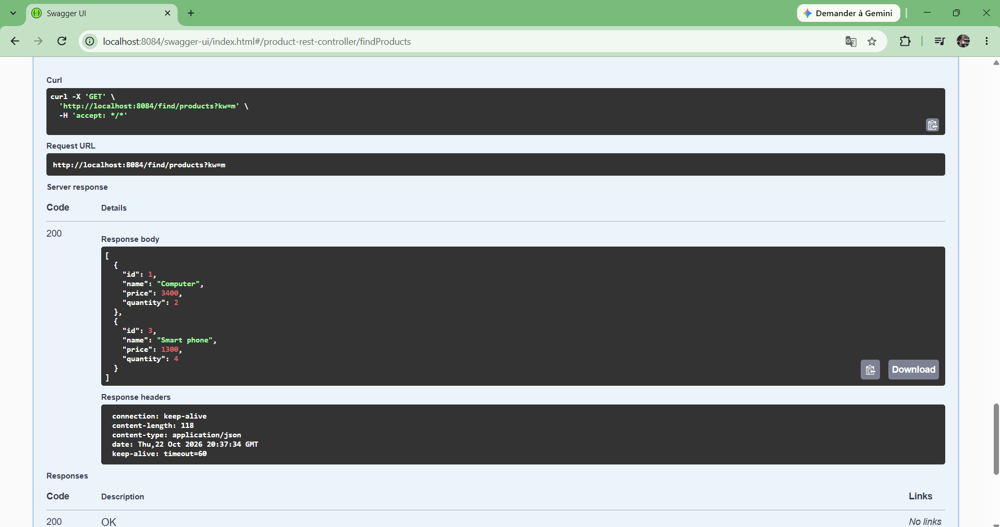

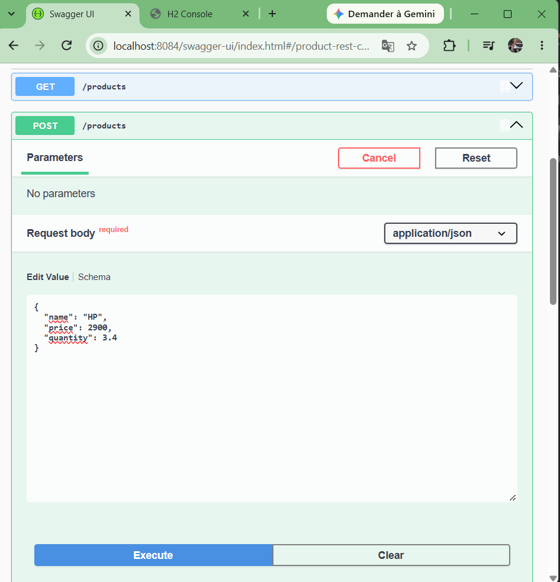

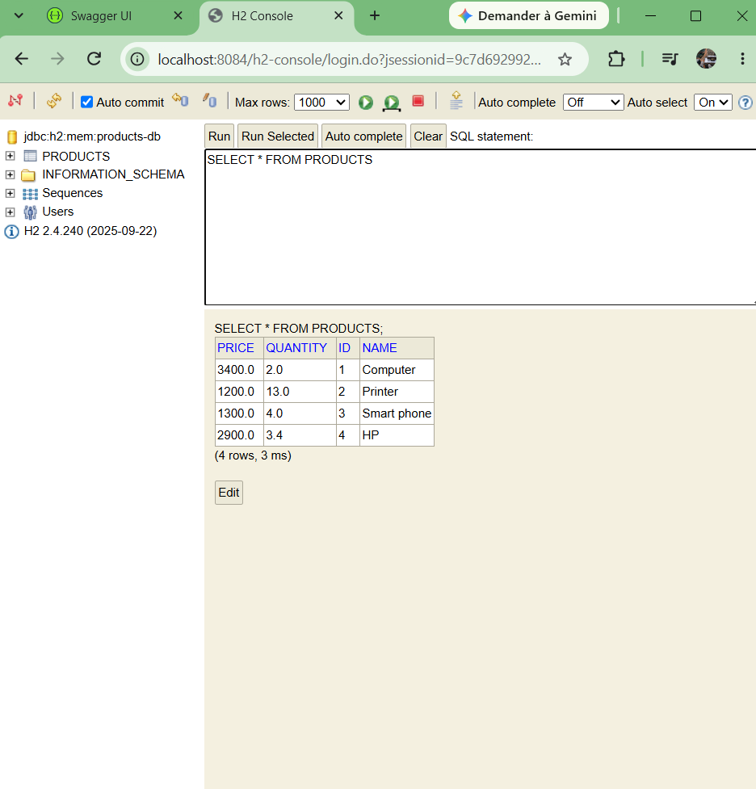

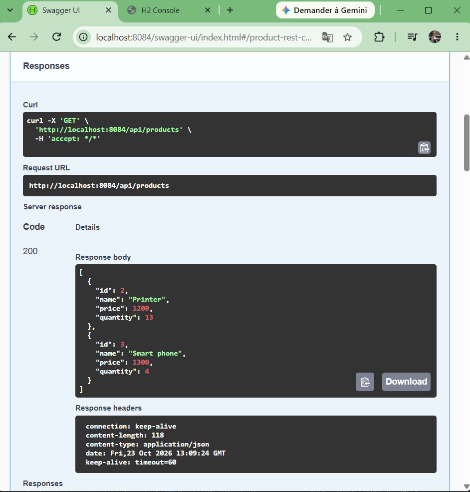

### Code du contrôleur

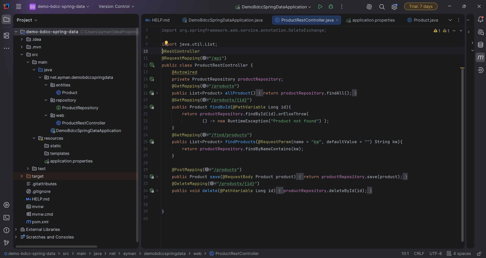

## Auteur

Ayman Asghar — TP universitaire Spring Data JPA.
